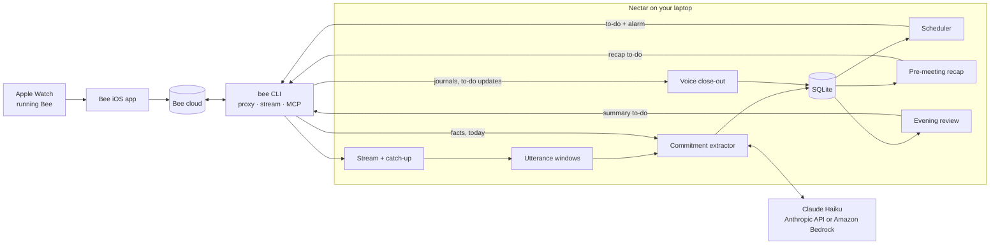

# Nectar

**Bee remembers what you said. Nectar makes sure you do it.**

Nectar is an ambient commitment agent for [Bee](https://docs.bee.computer/docs), Amazon's wearable AI. It listens to live conversation data from Bee on an Apple Watch, detects the promises you make ("I'll send Musa the price list by 3 PM"), and turns them into Bee to-dos whose alarms fire on your wrist. A voice note closes them out, and an evening review tells you what you kept.

Built for the Amazon Developer *Build, Ship, Shape* hackathon: **Bee (Wearable AI)** track, with the **AWS Builder** mini challenge.

> **Model provider.** The demo video and the numbers below run on the **Anthropic API** (`claude-haiku-5-5`). The new AWS account's Bedrock quotas stayed at 0 during the hackathon (see [FRICTION_LOG.md](FRICTION_LOG.md)), so the Bedrock path (`NECTAR_PROVIDER=bedrock`) is implemented and unit-tested but was not exercised live. AWS details: [docs/aws.md](docs/aws.md).


## What it does

| Moment | What Nectar does | On the wrist |
| --- | --- | --- |
| You make a promise in conversation | Detects it with Claude Haiku (the Anthropic API, or Amazon Bedrock), using your Bee facts and today's brief for names and times | — |
| Seconds later | Creates a Bee to-do with an alarm 10 min before it's due (or links an existing to-do or Bee suggestion) | `Send Musa the price list · due 3 PM` |
| 10 min before a meeting | Lists what you still owe the people you're about to meet | `10 AM Supplier call: you owe Send Musa the price list +1` |
| You say "done with the price list" | Completes the matching to-do | to-do checked off |
| 6 PM | Syncs what you finished, moves the rest to 9 AM tomorrow | `Nectar: 2/3 kept today. Open: Update the stock sheet` |

## Architecture



Nectar needs no custom watch app: everything reaches the wrist as native Bee to-dos and alarms.

## How it uses Bee

All Bee access goes through the official CLI, [`@beeai/cli`](https://docs.bee.computer/docs).

| Bee surface | Where in code | Used for |
| --- | --- | --- |
| `bee proxy`: local REST API at `127.0.0.1:8787/v1/*` | `src/bee/proxy.ts`, `src/bee/client.ts` | To-dos (create, update, complete), facts, conversations, daily summaries, changefeed |
| `bee stream --json`: live events | `src/bee/stream.ts` (`CliStreamSource`) | New utterances, conversations, journals, to-do updates |
| `GET /v1/stream`: SSE | `src/bee/stream.ts` (`SseStreamSource`) | Alternative live source (`NECTAR_STREAM_MODE=sse`) |
| `GET /v1/changes` with cursor | `src/bee/sync.ts` | Catch-up at startup and every 5 min; the stream is at-most-once |
| `bee mcp serve`: MCP over stdio | `src/ai/context.ts` (`McpContextProvider`) | Confirmed facts and today's brief as model context |
| `bee todos suggestions` / `accept-suggestion` | `src/bee/cli.ts`, `src/actions/scheduler.ts` | Accept Bee's own matching suggestion instead of duplicating it |
| `bee today --json` | `src/actions/recap.ts` | Calendar events for pre-meeting recaps |

AWS details for the AWS Builder mini challenge: [docs/aws.md](docs/aws.md).

## Quick start

Requirements: Node.js 22.13+, an Apple Watch running Bee with the Bee iOS app, and either an Anthropic API key or an AWS account with Bedrock access. To unlock **Developer Mode**: update the Bee iOS app to the latest version, open Settings, tap Version 5 times, then run `bee login` and `bee status`. If `bee status` says you are not authenticated, update the app and repeat.

```bash
npm i -g @beeai/cli && bee login && bee status   # 1. Bee CLI (after Developer Mode, above)
git clone https://github.com/Mammajam/Nectar.git && cd Nectar && npm install   # 2. Nectar
cp .env.example .env                     # 3. settings (defaults work)
npm run check:g0 -- --bedrock --alarm    # 4. check Bee + the model API (despite the flag name, it checks your NECTAR_PROVIDER)
npm run dev                              # 5. run it
```

For Bedrock, run `aws configure` and submit the one-time Anthropic use-case form in the Bedrock console ([docs/aws.md](docs/aws.md)). No Anthropic access yet? Set `NECTAR_MODEL_ID=us.amazon.nova-lite-v1:0`. No working Bedrock quota? Set `NECTAR_PROVIDER=anthropic` with `ANTHROPIC_API_KEY`, or `NECTAR_PROVIDER=openai` for a local model such as Ollama (see below).

Then talk near your watch. After 20 s of silence you'll see:

```
10:53:59  [commitment open] Send Musa the price list -> Musa | due 2026-10-12T15:00:00.000Z (95%)
10:53:59  [todo created] "Send Musa the price list · due 3 PM" alarm 2:50 PM (time from model)
10:54:01  [done via voice] Send Musa the price list ("the price list for Musa")
```

## Commands

| Command | What it does |
| --- | --- |
| `npm run dev` | Run Nectar |
| `npm run check:g0 -- [--stream 60] [--alarm] [--bedrock]` | Check Bee login, API, live stream, a test alarm, and Bedrock access |
| `npm run eval [-- --model <id>]` | Score extraction on 10 labeled conversations (gate: 80% correct, under 2 false positives) |
| `npm run commitments [-- --all]` | List captured commitments |
| `npm run schedule` | Create to-dos for open commitments that have none |
| `npm run review [-- --dry-run]` | Run (or preview) the evening review now |
| `npm test`, `npm run test:coverage`, `npm run typecheck`, `npm run build` | Development |

## Configuration

All settings live in `.env` (see [.env.example](.env.example)); defaults are shown.

| Variable | Default | Meaning |
| --- | --- | --- |
| `NECTAR_TIMEZONE` | `Africa/Monrovia` | Resolves "Friday" and "by 3 PM" |
| `NECTAR_PROVIDER` | `bedrock` | Model API: `bedrock`, `anthropic` (Anthropic's API directly) or `openai` (any OpenAI-compatible server, e.g. Ollama) |
| `NECTAR_MODEL_ID` | per provider: `us.anthropic.claude-haiku-4-5-20251001-v1:0`, `claude-haiku-4-5`, `llama3.1` | Model for the chosen provider (Bedrock model or inference profile) |
| `ANTHROPIC_API_KEY` | none | Key for `NECTAR_PROVIDER=anthropic` (or `NECTAR_LLM_API_KEY`); never logged |
| `NECTAR_LLM_BASE_URL` / `NECTAR_LLM_API_KEY` | provider default / none | Endpoint and key for `openai`; default endpoint is Ollama at `http://localhost:11434/v1` |
| `AWS_REGION` | `us-east-1` | Bedrock region |
| `NECTAR_WINDOW_PAUSE_MS` | `20000` | Silence before a conversation is analyzed |
| `NECTAR_MIN_CONFIDENCE` / `NECTAR_OPEN_THRESHOLD` | `0.4` / `0.7` | Drop below min; below open becomes "suggested" (no alarm) |
| `NECTAR_ALARM_LEAD_MIN` | `10` | Alarm before the due time |
| `NECTAR_WORKDAY_START` / `NECTAR_SAME_DAY_CUTOFF` | `9` / `16` | Untimed promises: due in 2 h before the cutoff, else next workday start |
| `NECTAR_REVIEW_TIME` | `18:00` | Evening review, or `off` |
| `NECTAR_RECAP` / `NECTAR_RECAP_LEAD_MIN` | `on` / `10` | Pre-meeting recap |
| `NECTAR_CATCHUP_MIN` | `5` | How often to fill gaps from the changefeed |
| `NECTAR_STREAM_MODE` | `cli` | `cli` (`bee stream`) or `sse` (proxy) |
| `NECTAR_EXTRACTION` / `NECTAR_CREATE_TODOS` | `on` / `on` | Turn off model calls or to-do writes |
| `NECTAR_LOG_LEVEL` | `info` | `debug` for verbose logs and stack traces |

## Reliability

- **Stream drops:** the live stream reconnects with exponential backoff; catch-up from `/v1/changes` runs at startup and every 5 min, and utterances are de-duplicated, so nothing is analyzed twice.
- **Proxy dies:** a watchdog checks `bee proxy` every minute and restarts it on the same port.
- **Bedrock throttling:** retried with backoff; access and credential errors print the exact fix.
- **No duplicates on the wrist:** existing Bee to-dos and Bee's own suggestions are matched before anything is created.
- **No alarms in the past:** overdue promises get a 15 min grace period.

## Project layout

| Path | Purpose |
| --- | --- |
| `src/bee/` | Bee client, live stream sources, SSE parser, catch-up, CLI wrapper, proxy launcher and watchdog |
| `src/ai/` | Windowing, Bee MCP context, prompt and tool schema, Bedrock client, extractor, evaluation |
| `src/actions/` | Scheduling and wrist text, to-do scheduler, voice close-out, evening review, pre-meeting recap |
| `src/pipeline.ts` | Utterances -> windows -> context -> extraction -> store |
| `src/store/db.ts` | SQLite (built-in `node:sqlite`): events, commitments, cursors |
| `scripts/` | Gate checks, evaluation, review and scheduling commands |
| `test/` | 152 tests (Vitest), about 94% line coverage |

## The Bee layer

Everything that talks to Bee lives in `src/bee/` and is independent of the rest of Nectar: a typed client for the proxy API, live stream sources with reconnect (CLI and SSE), an SSE parser, event classification for the documented payloads, and changefeed catch-up. It uses only Node built-ins, a small backoff helper (`src/util/backoff.ts`) and, for catch-up, the `Store` interface. It is not published as a separate package.

## Notes on Bee's API

Bee documents the CLI changefeed (`bee changed --json`) and the `bee stream` payloads ([Realtime](https://docs.bee.computer/docs/realtime), [Agentic Sync](https://docs.bee.computer/docs/agentic-sync)); Nectar's parsing and its test fixtures (`test/fixtures/bee-docs-payloads.json`) follow those pages. The REST proxy's own response shapes and `bee today --json` are not documented, so the client accepts several shapes for list responses, `/v1/changes`, conversation transcripts and `bee today`. `npm run check:g0` prints sample shapes from your account; anything surprising goes in [FRICTION_LOG.md](FRICTION_LOG.md).

**Conversation identity.** Stream events identify a conversation by `conversation_uuid`, while the changefeed and the API use a numeric `id`. Nectar keys conversations by uuid everywhere and keeps an id-to-uuid map in its store, so an utterance seen live and again in catch-up is stored once.

## Agent skill

The project ships Bee's official CLI skill (`.claude/skills/bee-cli/SKILL.md`, from [bee-computer/bee-skill](https://github.com/bee-computer/bee-skill), MIT) so a coding agent working in this repo knows the `bee` commands Nectar relies on: `bee now`, `bee todos`, `bee facts`, `bee search`. It is documentation only: no scripts, and it needs the Bee CLI login you already have. To update it, copy the latest `bee-cli/SKILL.md` from that repository over the local file.

## Privacy

Bee records the people around you. Ask for consent before recording colleagues. All Nectar data stays on your machine in `data/` (ignored by git); only the conversation window being analyzed is sent to the configured model provider: Amazon Bedrock by default, Anthropic's API if `NECTAR_PROVIDER=anthropic`, or nothing at all outside your machine with a local `openai`-compatible server such as Ollama.

## License

[MIT](LICENSE)
